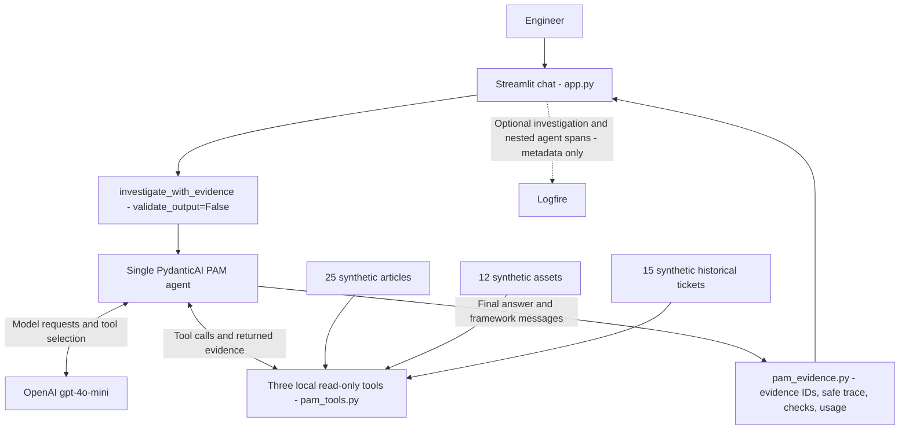
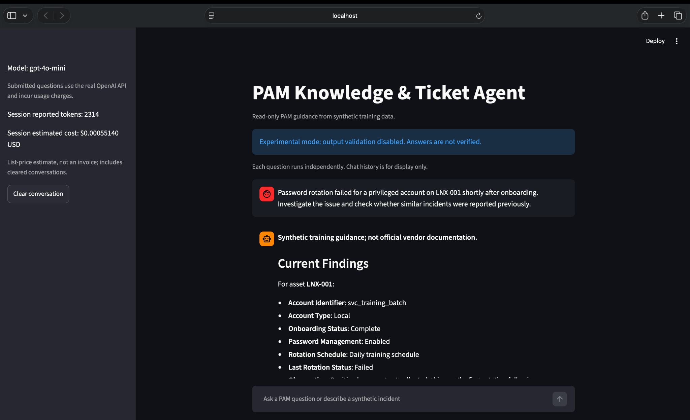
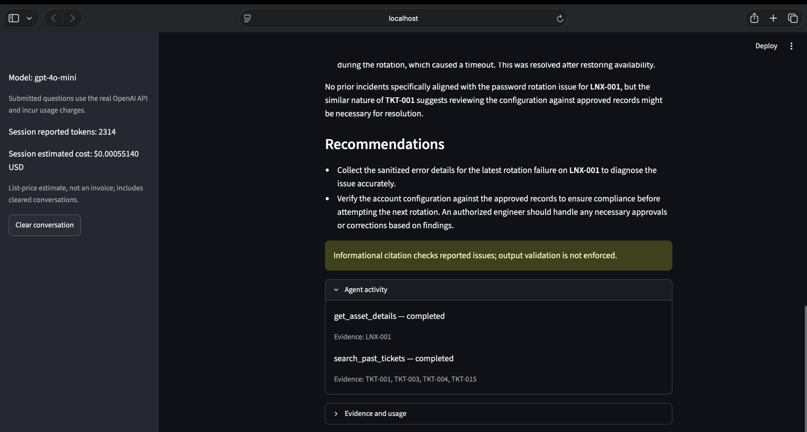
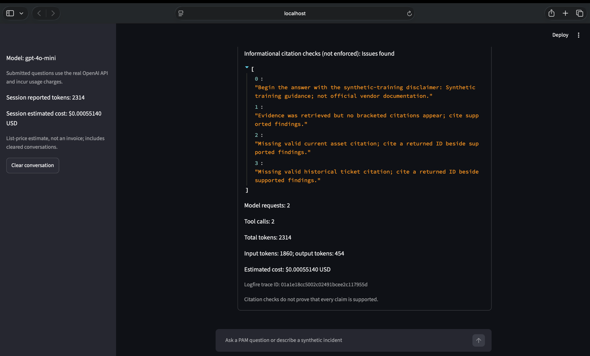
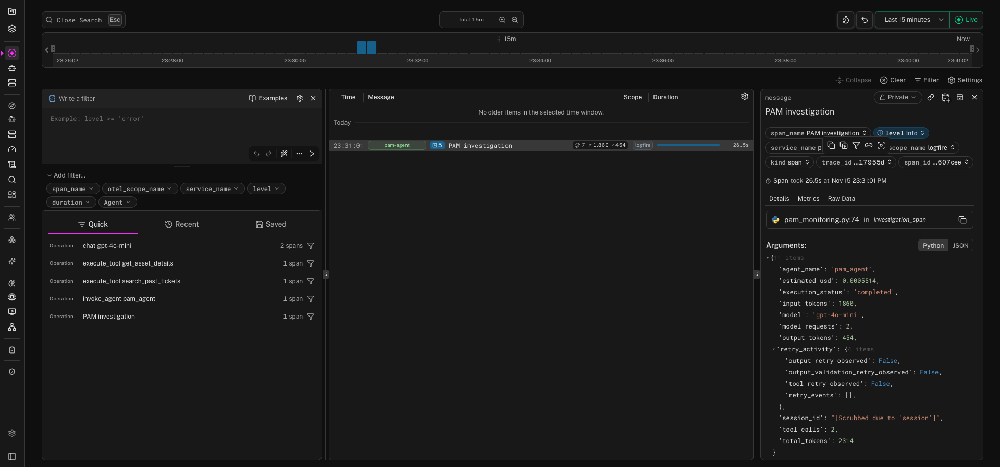

# Enterprise Security Knowledge & Ticket Resolution Agent

A working, read-only Privileged Access Management (PAM) assistant built with
PydanticAI, OpenAI `gpt-4o-mini` and Streamlit for an AI Engineering Buildcamp
capstone. It combines local knowledge, synthetic inventory and historical tickets
to support engineering investigations, with source IDs and observable tool use.

**Current evidence:** 50 real-model investigations, 20 human-reviewed responses,
and two structured judge iterations. The latest offline suite passed **219 tests**
with five paid tests skipped. Execution success does not establish answer correctness.

## Problem and business value

PAM troubleshooting often requires engineers to connect documentation, account
configuration and previous incidents. This project demonstrates a single interface
for gathering that context and making evidence gaps visible. Its intended value
is more consistent investigation support; time savings, customer outcomes and
production effectiveness have not been measured.

## Current capabilities and scope

- Knowledge Q&A and synthetic ticket investigation for Linux/Windows privileged
  account onboarding, password rotation/verification/policy failures and custom
  web connectors.
- One agent dynamically selects three read-only tools; each investigation allows
  at most six model requests and eight total tool executions.
- Streamlit chat displays answers, executed tools, evidence IDs, informational
  citation findings, token usage and estimated cost. Each question is independent;
  chat history is display-only and held in Streamlit session memory.
- A separate human evaluation console and versioned LLM judge operate on saved
  responses. They are not part of the chat agent's investigation loop.

**All PAM datasets are synthetic training data, not official vendor guidance or
validated production procedures.** The system has no live enterprise PAM, asset
inventory or ticketing connection and cannot change passwords, grant privileges,
remediate systems or perform escalations. Live inference uses OpenAI; optional
metadata export uses Logfire. This is a capstone prototype, not a production service.

## Architecture

Runtime investigation flow (evaluation tools are separate):



[The agent](pam_agent_pydantic.py) directs retrieval; [evidence helpers](pam_evidence.py)
derive citations and traces from actual linked tool returns, not IDs mentioned by
the model. [Diagnostics](pam_diagnostics.py) report safe failure metadata.
The UI and the collected agent batch call
`investigate_with_evidence(question, validate_output=False)`: **custom final-answer
rejection and correction are disabled; citation checks are informational.** Tool
argument validation and usage budgets remain active. Python entry points default
to `validate_output=True`, which enables bounded custom validation/correction;
that mode is not the evaluated Streamlit baseline. Neither mode proves semantic grounding.

## Tools and knowledge base

| Tool | Local source | Behavior |
|---|---|---|
| `search_documentation(query)` | [25 knowledge articles](data/pam_knowledge.json) | TF-IDF search, up to five records |
| `get_asset_details(asset_id)` | [12 asset records](data/pam_assets.json) | Exact normalized ID lookup; reports `asset_not_found` if absent |
| `search_past_tickets(query)` | [15 historical tickets](data/pam_tickets.json) | TF-IDF search, up to four records |

Retrieval uses `minsearch` word matching, with no embeddings or vector database.
Records/indexes are cached locally; restart the process if data changes. Historical
outcomes are comparisons, not proof of a current root cause. The curated expansion
preserves original records and excludes three proposed onboarding tickets after
ranking regressions; see [source provenance](docs/pam_expansion_sources.md) and
[the data review](docs/pam_expansion_review_results.md). Public references informed
synthetic concepts; the agent does not fetch those pages at runtime.

## Quick start using uv

Prerequisites: Git, Python **3.13+**, and `uv`. Run commands from the repository root.
Dependencies and the lockfile are in [pyproject.toml](pyproject.toml) and [uv.lock](uv.lock).

```sh
git clone --branch feature/streamlit-ui https://github.com/binayokbhowmikxp/security-knowledge-ticket-agent.git
cd security-knowledge-ticket-agent
uv sync --locked --group dev
```

For chat inference, create a local environment file only if one does not exist:

```sh
if [ ! -f .env ]; then cp .env.example .env; fi
```

Set `OPENAI_API_KEY` in `.env` using [the template](.env.example). Optionally add
`LOGFIRE_TOKEN` for monitoring; it is not included in the template. Keep credentials
local and never commit them. Offline tests and review of saved results need no
API key. Dependency installation requires package access; commands below do not
install a database or connect to an enterprise PAM platform.

## Running the Streamlit application

```sh
uv run streamlit run app.py
```

Open the local URL printed by Streamlit. Submitting a question makes real, paid
OpenAI requests; starting the UI does not run the model. Use synthetic inputs only.
For example: “Password rotation failed on LNX-001 shortly after onboarding.
Investigate the issue and check whether similar incidents were reported previously.”
The UI marks answers unverified; inspect source IDs, tool activity and missing
evidence before relying on guidance. Failed submissions are not automatically
repeated by the UI. Clear conversation removes displayed chat but keeps the
session's usage totals.

To inspect the saved answers without model calls, launch the separate
**PAM Agent Evaluation Console**:

```sh
uv run streamlit run evals/label_evals.py
```

It presents all 50 results and reconstructed, fingerprint-matched evidence records,
separating retrieved IDs from merely mentioned IDs. Good/Bad decisions require
human confirmation; Bad requires a primary failure category. Notes and labels
persist in [labels.csv](evals/labels.csv) using locked, atomic updates. Reviewing
is offline; confirming a changed label intentionally updates this human-review file.

## Demo Screenshots

These genuine, user-supplied captures show a **separate real LNX-001 Streamlit
investigation** and its corresponding Logfire trace. They are not the historical
S009/WIN-003 evaluation result. The pictured `gpt-4o-mini` run made **2 model
requests and 2 tool calls** (`get_asset_details`, `search_past_tickets`);
**documentation search was not called**. No new run was made to prepare these docs.

**Application and question.** The chat displays synthetic account findings and
keeps its unverified-output notice visible.



**Executed tools and transparent warnings.** Asset and historical-ticket retrieval
completed; informational citation checks reported issues rather than rejecting
or correcting the answer (`validate_output=False`).



**Evidence and usage.** Retrieved IDs were LNX-001, TKT-001, TKT-003, TKT-004 and
TKT-015 ([full evidence-ID and diagnostic view](docs/screenshots/05_evidence_ids_citation_diagnostics.png)).
The run reported **1,860 input / 454 output / 2,314 total tokens**, at an estimated
**$0.00055140 USD**; the panel also supplies its Logfire trace ID.



**Corresponding Logfire view.** The supplied crop shows the investigation,
model/tool operation counts and matching usage attributes. Personal account and
organization information was removed in the supplied crop; no further image edits
were made. This is a captured trace view, not a claim of perpetual dashboard access.



Supplementary answer views: [asset findings and possible causes](docs/screenshots/02_asset_findings_possible_causes.png)
and [historical tickets and recommendations](docs/screenshots/03_historical_tickets_recommendations.png).
The response is **not independently verified as technically correct**. Historical
outcomes do not establish this incident's cause, and future tool choices are not
guaranteed. Warnings and answer defects are preserved, not edited away.
See the [walkthrough](docs/demo_walkthrough.md) and
[evidence checklist](docs/demo_evidence_checklist.md) for provenance, limitations
and the distinction from S009. These captures do not alter the frozen 50-case batch
or its evaluation metrics.

## Testing and verification

```sh
uv run pytest -q
uv run python evals/run_batch.py --dry-run
uv run python evals/run_judge.py --version v1 --dry-run
uv run python evals/run_judge.py --version v2 --dry-run
```

Latest verified full suite: **219 passed, 5 skipped, 19 subtests passed**, with one
existing Python event-loop deprecation warning. Live tests require an explicit
`--live` flag and are skipped by default. Offline scripted-model and UI tests
exercise real framework/tool contracts, storage and failure handling; they do not
measure genuine LLM reasoning or answer correctness.

Dry-runs validate inputs and saved fingerprints without OpenAI calls. The saved
batch and V2 journals are complete (zero unstarted cases); V1 is verification-only.
Runners require `feature/streamlit-ui`, preserve per-scenario reservations and skip
started investigations, including failures/interrupted calls. Do not delete saved
journals to force replay. A new paid collection requires separate authorization.
For the existing collection command and historical test details, see
[development history](docs/development_history.md).

## Evaluation results

### 1. Real-agent collection

The [50 approved scenarios](evals/scenarios.csv) include 15 happy paths, 12 varied
phrasings, 10 edge cases, six out-of-scope requests and seven breaking cases.
Topics: 13 onboarding, 16 password rotation, 15 web connector and six out-of-scope.

All **50 real `gpt-4o-mini` investigations completed**, with zero execution failures,
88 model requests and 52 tool calls. The batch used `validate_output=False` and
no automatic investigation/SDK retries. Reported usage was **92,109 tokens**
(80,382 input / 11,727 output), estimated **$0.01909350 USD**.
**27 answers failed informational citation checks; 33 scenarios had full
informational findings**, including those citation failures. These are overlapping
heuristic findings, not answer-quality scores or 33 additional failures.

[Results JSONL](evals/results.jsonl) contains 100 events: 50 started reservations and
50 terminal `event="result"` records. [The CSV](evals/results.csv) contains the 50
answers for review. [The batch report](evals/batch_report.md) explains traces,
fingerprints, tool choices and limitations. Generated answers are preserved as
returned, not silently corrected for presentation.

### 2. Human review

A human reviewed **20 responses: 10 Good and 10 Bad**; 30 remain unlabeled.
The Bad categories were wrong evidence/citation (5), hallucination (3), incorrect
tool use (1) and incomplete response (1). [Saved labels](evals/labels.csv) include
reviewer notes. This selected subset is not a representative estimate of quality
across all 50 questions or real enterprise incidents.

### 3. Structured LLM judge

A separate PydanticAI judge returns `reasoning` followed by `label` (`good`/`bad`).
Both versions evaluated the same 20 labeled answers once, with no execution errors
or automatic retries. Human labels and notes were withheld from judge inputs;
reference inventory was clearly separated from trace-confirmed retrieved evidence.

| Metric (Bad is positive) | V1 | V2 |
|---|---:|---:|
| Accuracy against human labels | 55% | 70% |
| Precision (Bad) | 52.63% | 62.5% |
| Recall (Bad) | 100% | 100% |
| TP / FP / FN / TN | 10 / 9 / 0 / 1 | 10 / 6 / 0 / 4 |

V2 first distinguishes investigations, clarifications, security refusals, procedural
answers and out-of-scope replies before applying citation requirements. It corrected
S028, S044 and S048 with no prediction regressions; six disagreements remain.
**S028** honestly reports `asset_not_found` and requests identifying details: V1
wrongly demanded a citation to the nonexistent record; V2 accepted the response.

**V2 metrics are in-sample:** those same 20 reviewed examples informed its prompt
improvement. The gain is agreement on this subset, not held-out performance or
proof of judge correctness. [V1's report](evals/judge_v1_report.md),
[V2's report](evals/judge_v2_report.md) and [the comparison](evals/judge_v2_comparison.json)
preserve all disagreements, reasoning, tokens and cost estimates. V1/V2 used
33,535 / 44,359 tokens, estimated $0.00618405 / $0.00773745 USD respectively.

### Offline retrieval comparison

A separate [20-query draft benchmark](docs/retrieval_benchmark.md) compares the
unchanged production TF-IDF functions with unique keyword overlap on the same
fields and collections (10 article queries at K=5, 10 ticket queries at K=4).
Both reach 100% Hit@K. Keyword overlap scores higher overall: Hit@1 **95% vs 90%**,
Recall@K **95% vs 87.08%**, MRR@K **0.9750 vs 0.9417**. TF-IDF does better on the
restricted-account ticket query; both methods miss complementary onboarding
sources on some queries. The [questions](evals/retrieval_questions.csv) and
[rankings](evals/retrieval_benchmark_results.json) preserve draft relevance reasons
and reproducibility fingerprints.

These are source-informed, handcrafted coding-assistant judgments, not independent
ground truth. They were fixed before running the two methods and not adjusted to
improve scores. This small result favors the keyword baseline, not a claim of
TF-IDF superiority. Production retrieval remains unchanged pending independent
review and broader evaluation. No agent, judge or OpenAI calls were made.

```sh
uv run python evals/retrieval_benchmark.py
uv run pytest evals/test_retrieval_benchmark.py -q
```

## Monitoring with Logfire

Add a write token as `LOGFIRE_TOKEN` in local `.env` to enable the existing
[monitoring helpers](pam_monitoring.py) for chat and batch agent investigations.
Without it, export is disabled. In Logfire, filter service `pam-agent` and use the
saved trace ID to follow the investigation root span and nested agent/model/tool
activity. The collected 50-case batch recorded **50 trace IDs**; retained ingestion
acknowledgements were HTTP 200. Dashboard visibility for that historical batch
was not independently verified. The separate LNX-001 demo now has a supplied
matching dashboard capture, shown above; it is not a screenshot of S009.
The manual console uses saved files; V1/V2 judge runs did not enable Logfire export.

Instrumentation excludes question/answer content, raw provider messages and
exception payloads; metadata such as model, timing, usage and tool activity is
exported. Questions, retrieved synthetic records and model replies are exchanged with OpenAI
for inference. Questions and answers remain unredacted in local UI/evaluation artifacts. Use synthetic data, not customer
records or credentials. Clear chat is not a privacy purge of all application state.

The UI reports token usage and session estimates using repository constants of
$0.15 input / $0.60 output per million tokens. Estimates exclude cache discounts
and billing adjustments; partial failed-run usage is explicitly incomplete.
Monitoring does not validate answer quality.

## Limitations and future improvements

- **Unenforced final-answer checks in chat:** citation membership and lexical
  documentation checks cannot establish claim-level support, even when they pass.
  Tools can be omitted or irrelevant records retrieved; historical outcomes do not
  establish current causes.
- **Lexical retrieval:** fixed result limits and cross-platform word overlap can
  displace useful evidence. A small draft benchmark is complete; independent
  relevance review and broader evaluation should precede retrieval changes.
- **Limited evaluation:** only 20 human labels, 30 unlabeled answers, six remaining
  judge disagreements and no held-out judge validation. Broader human review and
  an independent holdout set are future work, not completed results.
- **Local prototype:** no authentication, persistent chat store, production PAM
  integration, autonomous remediation or completed cloud deployment. No measured
  customer benefit or production-readiness claim.
- Reviewed UI/Logfire captures and a demo walkthrough are available above; a
  recorded presentation and fully expanded trace-tree capture are not included.
  Notebooks remain teaching artifacts with their own legacy orchestration; their
  paid cells are not needed to run the app.

## Documentation and evidence

| Resource | Purpose |
|---|---|
| [Project context](PROJECT_CONTEXT.md) | Current scope, engineering constraints and decisions |
| [Demo walkthrough](docs/demo_walkthrough.md) / [evidence checklist](docs/demo_evidence_checklist.md) | Reviewed screenshots, separate run identities and presentation limits |
| [Development history](docs/development_history.md) | Preserved prior README/context, migration explanations and historical commands |
| [Source provenance](docs/pam_expansion_sources.md) | Public conceptual references and synthetic-data boundaries |
| [Data integration review](docs/pam_expansion_review_results.md) | Ranking regression, curation and original-record integrity |
| [Retrieval comparison artifact](docs/pam_expansion_retrieval_resolution.json) | Saved original/expanded/curated rankings |
| [Draft retrieval benchmark](docs/retrieval_benchmark.md) | TF-IDF versus keyword overlap, methodology, scores and limitations |
| [Batch report](evals/batch_report.md) | Real-agent collection evidence and limitations |
| [Human evaluation console](evals/label_evals.py) / [labels](evals/labels.csv) | Manual review and notes |
| [V1 prompt](evals/judge_prompts/v1.txt) / [predictions](evals/judge_v1_results.csv) | Frozen baseline judge |
| [V2 prompt](evals/judge_prompts/v2.txt) / [predictions](evals/judge_v2_results.csv) | Targeted, frozen judge iteration |
| [V2 report](evals/judge_v2_report.md) | Metric comparison and S028 corrected-disagreement example |
| [Learning notebooks](notebooks/) | Setup, early retrieval and manual agent experiments |
